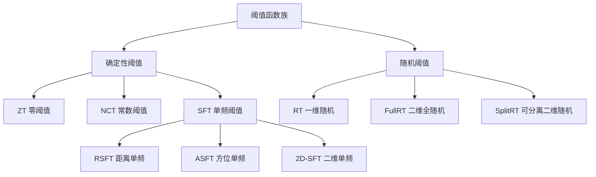
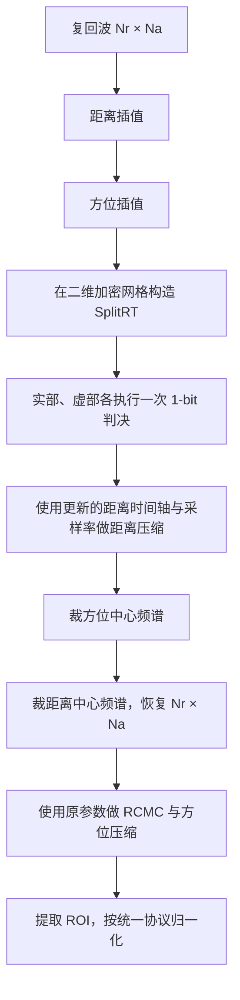

# SAR 1-bit 量化与上采样技术手册

> 面向新手的一体化技术手册。完整收录知识库中 SAR 方向的全部有效技术内容，所有公式与代码自包含，不依赖任何外部文件，可直接复现。
>
> 读完本手册，你应当能够：理解 1-bit 量化约定；掌握零阈值、常数阈值、随机阈值、单频阈值各族的构造方法；完成距离向、方位向及双向（BARU）上采样；并跑通一条从复回波到 1-bit 码字再到成像的端到端流程。

## 目录

- 0 文档说明
- 1 统一约定与背景
  - 1.1 矩阵与维度约定
  - 1.2 非对称符号函数
  - 1.3 加阈值约定
  - 1.4 码字集合
  - 1.5 背景与总体目标
- 2 1-bit 量化核心
  - 2.1 量化器定义
  - 2.2 通用阈值矩阵量化器
  - 2.3 最小调用流程
  - 2.4 使用检查清单
- 3 幅度尺度估计
- 4 噪声模型
- 5 阈值函数族
  - 5.1 分类总览与随机自由度
  - 5.2 ZT 零阈值
  - 5.3 NCT 常数阈值
  - 5.4 RT 随机阈值系列（RT / FullRT / SplitRT）
  - 5.5 SFT 单频阈值系列（SFT / RSFT / ASFT / 2D-SFT）
- 6 上采样算子
  - 6.1 Range-up 距离向上采样
  - 6.2 Azimuth-up 方位向上采样
  - 6.3 BARU 距离—方位双向上采样
- 7 端到端流程与快速上手
- 附录 A 函数速查表
- 附录 B 检查清单汇总
- 附录 C 约定陷阱清单
- 附录 D 术语与记号表

---

## 0 文档说明

### 0.1 目标读者

- 刚接触本课题、需要快速理解现有工作的人；
- 需要在 MATLAB 中复现量化与上采样实验的人；
- 需要在此基础上继续扩展阈值类型或上采样方式的人。

### 0.2 内容范围

本手册覆盖以下全部内容（对应知识库中的 15 篇 SAR 笔记）：

- 1-bit 量化统一约定与通用量化器；
- 幅度尺度估计；
- 复高斯噪声模型；
- 阈值函数族共 9 类：ZT、NCT、RT、FullRT、SplitRT、SFT、RSFT、ASFT、2D-SFT；
- 上采样算子：距离向上采样、方位向上采样、双向 BARU。

不在本手册内的内容：SAR 回波模型、LFM 调频、距离/方位压缩的完整理论推导（知识库中该部分仍为占位，尚未补齐）。本手册聚焦"量化 + 上采样"这条主线，成像流程仅作为下游接口出现。

### 0.3 运行环境

- MATLAB（R2016b 及以上，代码使用了隐式扩展与 `"like"` 参数；建议 R2019b+）。
- 不需要任何附加工具箱，全部函数仅使用基础 FFT、随机数和数组操作。
- 代码内部使用全局 `randn`，复现时统一用 `rng(seed, "twister")` 固定种子。

### 0.4 阅读路径建议

- 只想用：读 1 → 2 → 7，再按需查 5、6 的函数。
- 想搞懂全部：按 1 → 2 → 3 → 4 → 5 → 6 → 7 顺序读。
- 要改实验：重点看 5（阈值）和 6（上采样），以及附录 B 的检查清单与附录 C 的陷阱清单。

### 0.5 全局约定速览

| 约定 | 内容 |
|---|---|
| 矩阵维度 | 第 1 维 = 距离（行 / 快时间），第 2 维 = 方位（列 / 慢时间） |
| 信号记号 | 复回波 $S\in\mathbb C^{N_r\times N_a}$，上采样后 $S^\uparrow\in\mathbb C^{N_r^\uparrow\times N_a^\uparrow}$ |
| 量化形式 | $y=\operatorname{sgn}_+(\Re(S+U))+j\operatorname{sgn}_+(\Im(S+U))$ |
| 零值规则 | $\operatorname{sgn}_+(0)=+1$，不产生零码字 |
| 阈值符号 | 采用**加阈值**约定 $S+U$ |
| 码字集合 | $\{1+j,\ 1-j,\ -1+j,\ -1+j\}$ 的四个点 |

---

## 1 统一约定与背景

### 1.1 矩阵与维度约定

本手册所有算子统一约定：**第 1 维是距离向（快时间），第 2 维是方位向（慢时间）**。

- 复回波写作 $S\in\mathbb C^{N_r\times N_a}$，行索引 $n$ 对应距离采样，列索引 $m$ 对应方位脉冲；
- 第 1 维对应 FFT 的 `dim = 1`，第 2 维对应 `dim = 2`；
- "距离向上采样"操作第 1 维，"方位向上采样"操作第 2 维。

混淆维度是最常见的错误来源。代码中所有 FFT、补零、裁剪都必须与这一约定一致。

### 1.2 非对称符号函数

定义非对称符号函数

$$
\operatorname{sgn}_+(x)=
\begin{cases}
-1,&x<0,\\
+1,&x\ge 0.
\end{cases}
$$

它在 $x=0$ 处取 $+1$，与 MATLAB 内置 `sign`（在 $0$ 处返回 $0$）不同。

**实现要点**：代码不调用 `sign`，而是先把结果初始化为全 `+1`，再把"严格小于零"的位置改成 `-1`。因此输入恰好为零时输出 `+1`，不会出现零码字。

```matlab
% 正确的 sgn_+ 实现方式
re = ones(size(S), "like", real(S));
re(real(S) < 0) = -1;   % 严格小于 0 才置 -1，等于 0 保持 +1
```

### 1.3 加阈值约定

本手册的 1-bit 量化统一采用**加阈值**约定

$$
y=\operatorname{sgn}_+\!\left(\Re(S+U)\right)+j\operatorname{sgn}_+\!\left(\Im(S+U)\right),
$$

即把复阈值矩阵 $U$ 加到复回波 $S$ 上，再对实部、虚部分别判决。

**符号统一说明**：如果别的实现写成 $S-\tau$（减阈值），则两者阈值变量满足 $U=-\tau$。跨实现复用时必须先统一符号，否则判决边界会整体反号。

### 1.4 码字集合

由于实部、虚部各自只有 $\pm1$ 两种取值，量化输出只可能落在四个点上：

$$
y\in\{1+j,\ 1-j,\ -1+j,\ -1-j\}.
$$

因此该量化器是真正意义上的 **1-bit / 每通道两电平** 量化。

### 1.5 背景与总体目标

SAR 原始回波在采集端被 1-bit（每实/虚通道 1 bit）量化，可以显著降低数据率与硬件成本，但会引入强非线性失真。为改善量化后的成像质量，本课题的思路是：**在量化之前对回波施加一个精心设计的阈值场 $U$**，通过改变判决边界来保留更多有用信息。

围绕这一思路，工作分为两支：

1. **阈值设计**：ZT / NCT / RT 系列 / SFT 系列，决定阈值场 $U$ 的形态；
2. **采样网格设计**：距离/方位上采样，决定量化在哪个网格上进行，并在成像阶段裁剪回原尺寸。

二者组合使用，即构成完整实验方案。

> 说明：SAR 回波模型、LFM 调频、距离/方位压缩的理论基础部分，知识库中目前仍是占位状态，尚未补齐。本手册不展开该部分。

---

## 2 1-bit 量化核心

本节是全部阈值方案的公共基础。所有阈值类型（ZT / NCT / RT / FullRT / SplitRT / SFT 系列）都共用这里的量化规则与通用量化器。

### 2.1 量化器定义

$$
y=\operatorname{sgn}_+\!\left(\Re(S+U)\right)
+j\operatorname{sgn}_+\!\left(\Im(S+U)\right),
$$

其中 $\operatorname{sgn}_+$ 见 1.2。输出码字属于 $\{1+j,\,1-j,\,-1+j,\,-1-j\}$。

### 2.2 通用阈值矩阵量化器

核心代码：

```matlab
function S1 = quantizeWithThreshold(S, U)
    assert(isequal(size(S), size(U)), "信号与阈值尺寸不一致。");
    re = ones(size(S), "like", real(S));
    im = ones(size(S), "like", real(S));
    re(real(S) + real(U) < 0) = -1;
    im(imag(S) + imag(U) < 0) = -1;
    S1 = complex(re, im);
end
```

- `S`：待量化复回波，二维数值矩阵；
- `U`：复阈值矩阵，尺寸必须与 `S` 完全一致；
- `S1`：与 `S` 同尺寸的复数 1-bit 码字矩阵。

如果希望使用 $N_r\times 1$ 或 $1\times N_a$ 的方向阈值，应先通过隐式扩展构造完整矩阵，或使用支持广播且带明确尺寸检查的量化器。

### 2.3 最小调用流程

以可分离随机阈值 SplitRT 为例，一个最小可用流程如下：

```matlab
% 1. 输入必须是二维复回波
assert(~isreal(signal_up), "输入应为复回波。");

% 2. 固定随机种子，保证随机阈值可复现
rng(2026, "twister");

% 3. 构造与输入同尺寸的阈值场
U = buildSplitRTThreshold(signal_up, As);
assert(isequal(size(signal_up), size(U)), ...
    "信号与阈值尺寸不一致。");

% 4. 实部、虚部分别执行二值判决
channel_1bit = quantizeWithThreshold(signal_up, U);
```

### 2.4 使用检查清单

1. 确认输入是复回波，而不是幅度图或强度图。
2. 确认距离为行、方位为列，阈值相位方向没有交换。
3. 确认阈值使用 `S+U` 还是 `S-U` 的符号约定。
4. 确认阈值与上采样回波尺寸一致，或广播方向符合设计。
5. 确认实部和虚部采用完全相同的判负规则。
6. 确认零值映射规则：本文函数将零映射为 `+1`。
7. 比较随机阈值时固定 seed，并记录全局 RNG 或局部流协议。
8. 二维阈值应将两个方向的相位相加后取复指数。
9. 使用线性相位阈值时，检查时间轴、采样率和频率单位是否一致。

---

## 3 幅度尺度估计

随机阈值（RT / SplitRT / FullRT）和单频阈值（SFT 系列）都需要一个与信号幅度匹配的阈值幅度。本节给出从回波估计幅度尺度 $\hat{\sigma}$ 的方法。

### 3.1 幅度尺度估计公式

$$
\hat{\sigma}=\sqrt{\frac{2}{\pi}}\operatorname{mean}(|S|),
$$

其中 $S$ 为**上采样后**的复回波矩阵，$\operatorname{mean}(|S|)$ 为所有复采样点幅度的均值。

**推导**：若 $|S|$ 服从参数为 $\sigma$ 的瑞利分布（复高斯假设下成立），则 $E[|S|]=\sigma\sqrt{\pi/2}$，故

$$
\hat{\sigma}=\sqrt{2/\pi}\cdot E[|S|].
$$

### 3.2 两类阈值的幅度取值

| 用途 | 公式 | 说明 |
|---|---|---|
| RT / SplitRT / FullRT 幅度 | $A_{\mathrm{RT}}=A_s\hat{\sigma}$ | $A_s$ 为用户设定的幅度比例系数 |
| SFT 幅度（信号阈值比 STR） | $A_u=\dfrac{\hat{\sigma}}{10^{\mathrm{STR}_{dB}/20}}$ | 用 `/20` 因为 STR 是幅度比而非功率比 |

### 3.3 函数与用法

```matlab
function sigma_hat = estimateSigma(signal_up)
    sigma_hat = sqrt(2 / pi) * mean(abs(signal_up(:)));
end
```

```matlab
% RT / SplitRT 幅度
sigma = sqrt(2 / pi) * mean(abs(signal_up(:)));
A_rt = As * sigma;

% SFT 幅度
A_u = sigma / (10 ^ (STR_dB / 20));
```

### 3.4 注意事项

- $\hat{\sigma}$ 必须由**与阈值尺寸一致的上采样回波**计算，不能使用原始未上采样的信号。
- 该估计假设信号幅度服从瑞利分布（复高斯假设），适用于 SAR 回波的统计特性。

---

## 4 噪声模型

为了在指定 SNR 下评估量化与成像性能，需要一个加性复高斯白噪声生成函数。

### 4.1 数学定义

设干净复回波 $s\in\mathbb C^{N_r\times N_a}$，矩阵元素总数为 $N$，信号平均功率

$$
P_s=\frac{1}{N}\sum_{i=1}^{N}|s_i|^2.
$$

目标输入信噪比 $\mathrm{SNR}_{dB}$ 时，目标复噪声功率

$$
P_n=P_s\cdot 10^{-\mathrm{SNR}_{dB}/10}.
$$

复高斯噪声由相互独立的实部与虚部构成：

$$
n_i=\sqrt{\frac{P_n}{2}}\left(\xi_i^{(R)}+j\xi_i^{(I)}\right),
\qquad \xi_i^{(R)},\xi_i^{(I)}\overset{\mathrm{i.i.d.}}{\sim}\mathcal N(0,1).
$$

每个实分量方差为 $P_n/2$，复噪声总功率为 $P_n$。噪声加在量化前：

$$
\widetilde{s}=s+n.
$$

### 4.2 函数接口与实现

```matlab
function [Noise, stats] = gaussian(signal, SNR_dB, verbose)
    if nargin < 3, verbose = true; end

    signal_power = mean(abs(signal(:)) .^ 2);
    target_noise_power = signal_power / (10 ^ (SNR_dB / 10));
    scale_factor = sqrt(target_noise_power) / sqrt(2);

    [rows, cols] = size(signal);
    Noise = scale_factor * ...
        (randn(rows, cols) + 1j * randn(rows, cols));
    Noise = Noise - mean(Noise, "all");

    % 有限样本统计
    actual_noise_power = mean(abs(Noise(:)) .^ 2);
    actual_SNR_dB = 10 * log10(signal_power / actual_noise_power);

    stats = struct( ...
        "TargetSNRdB", SNR_dB, ...
        "ActualSNRdB", actual_SNR_dB, ...
        "SignalPower", signal_power, ...
        "TargetNoisePower", target_noise_power, ...
        "ActualNoisePower", actual_noise_power, ...
        "TargetNoiseStd", sqrt(target_noise_power / 2), ...
        "ActualNoiseStd", sqrt(actual_noise_power / 2), ...
        "NoiseMean", mean(Noise, "all"));

    if verbose
        fprintf("Target SNR: %.3f dB | Actual SNR: %.3f dB\n", ...
            SNR_dB, actual_SNR_dB);
    end
end
```

**输入**

- `signal`：复回波矩阵，用于估计信号功率；
- `SNR_dB`：目标输入 SNR，单位 dB；
- `verbose`：是否打印统计信息，缺省 `true`。

**输出**

- `Noise`：与 `signal` 同尺寸的复高斯噪声矩阵；
- `stats`：结构体，含 `TargetSNRdB` / `ActualSNRdB` / `SignalPower` / `TargetNoisePower` / `ActualNoisePower` / `TargetNoiseStd` / `ActualNoiseStd` / `NoiseMean`。

函数**只返回噪声**，不直接返回 `signal + Noise`，由调用方自行相加。

### 4.3 调用方式

```matlab
% 基本调用
rng(seed);
[noise, stats] = gaussian(signal, SNR_dB, false);
noisy_signal = signal + noise;
```

```matlab
% 可重复调用：函数内部使用全局 randn，需在调用前固定随机种子
seed = 2026;
rng(seed, "twister");
[noise, stats] = gaussian(signal, 5, false);
```

```matlab
% 严格功率归一化（可选）：减均值后未再次精确归一化到目标功率
Noise = Noise * sqrt(target_noise_power / ...
    mean(abs(Noise(:)) .^ 2));
```

### 4.4 关键性质

1. 噪声实部和虚部独立，使用相同方差 $P_n/2$。
2. 生成后减去有限样本复均值，使噪声均值接近机器精度零。
3. 减均值后未再次归一化功率，`ActualSNRdB` 通常接近但不严格等于 `TargetSNRdB`。
4. 直接使用全局 `randn`，可重复性依赖外部 `rng(seed)`。
5. 返回矩阵默认为 double，未转换为输入 `signal` 的数值类型。
6. 生成的是加性复高斯白噪声，**不是**乘性 speckle 噪声。

### 4.5 使用检查清单

1. SNR 在复回波域定义，不是幅度图或强度图。
2. 使用 `mean(abs(signal(:)).^2)` 计算复信号功率。
3. 复高斯实部和虚部各使用目标总功率的一半。
4. 记录目标 SNR 与有限样本实际 SNR。
5. 需要复现时固定 seed，避免改变随机数调用顺序。
6. 注意返回类型为 double；若输入为 single，显式转换。

---

## 5 阈值函数族

### 5.1 分类总览与随机自由度



各类阈值的随机自由度（独立随机变量个数）对照：

| 类型 | 阈值形式 | 随机自由度 |
|---|---|---|
| ZT | $U=0$ | 0 |
| NCT | $U=Ae^{j\psi}$ | 0 |
| SFT 系列 | $U$ 为线性相位复指数 | 0 |
| RT（一维） | 距离向或方位向随机相位 | $N_r^\uparrow$ 或 $N_a^\uparrow$ |
| SplitRT | $\phi_r(n)+\phi_a(m)$ | $N_r^\uparrow+N_a^\uparrow$ |
| FullRT | $\phi_{n,m}$ 逐点独立 | $N_r^\uparrow\times N_a^\uparrow$ |

阈值幅度统一参见第 3 节：随机族用 $A_{\mathrm{RT}}=A_s\hat{\sigma}$，SFT 族用 $A_u=\hat{\sigma}/10^{\mathrm{STR}_{dB}/20}$。

### 5.2 ZT 零阈值

**定义**：零阈值。不施加额外阈值，直接对复回波做 1-bit 量化。最简单的方案，作为基准量化器。

**公式**

$$
U=0,\qquad y=\operatorname{sgn}_+(\Re S)+j\operatorname{sgn}_+(\Im S).
$$

**用途**：作为不施加阈值时的基准，与其他阈值方案对比。

**输入**：`S` 二维复回波矩阵。
**输出**：`S1` 与 `S` 同尺寸的复数 1-bit 码字矩阵。

**MATLAB 实现**

```matlab
function S1 = quantize_1bit_zero(S)
    re = ones(size(S), "like", real(S));
    im = ones(size(S), "like", real(S));
    re(real(S) < 0) = -1;
    im(imag(S) < 0) = -1;
    S1 = complex(re, im);
end
```

**Notes**

- ZT 没有单独的阈值构造函数，$U=0$ 隐含在量化器中。
- 输入输出尺寸完全相同；随机自由度为 0。
- 零值映射为 $+1$。

### 5.3 NCT 常数阈值

**定义**：非减法常数阈值（Non-subtractive Constant Threshold）。整个回波矩阵共享同一个复数阈值 $U=Ae^{j\psi}$。取 $\psi=0$ 时为纯实阈值；非零 $\psi$ 会同时改变实部和虚部的判决边界。

**公式**

$$
U=Ae^{j\psi},
\qquad
y=\operatorname{sgn}_+(\Re(S+U))+j\operatorname{sgn}_+(\Im(S+U)).
$$

**用途**：引入一个全局复常数偏置来改变量化判决边界；实现简单，随机自由度为 0。

**输入**：`S` 待量化复回波；`A` 阈值幅度（标量）；`psi` 阈值复平面方向角（弧度，标量）。
**输出**：`S1` 同尺寸复 1-bit 码字矩阵。

**MATLAB 实现**

```matlab
function S1 = quantize_1bit_nct(S, A, psi)
    u = A * exp(1i * psi);
    re = ones(size(S), "like", real(S));
    im = ones(size(S), "like", real(S));
    re(real(S) + real(u) < 0) = -1;
    im(imag(S) + imag(u) < 0) = -1;
    S1 = complex(re, im);
end
```

**Notes**

- `A` 控制阈值幅度，`psi` 控制复平面方向。
- 若希望阈值随输入幅度尺度变化，可使用 $A=A_s\hat{\sigma}$（见第 3 节）；若已有绝对幅度标定，也可直接传入固定 `A`。
- 该函数把常数阈值构造与量化合并在一起。
- 加阈值约定为 $S+U$；若其他实现写成 $S-\tau$，则 $U=-\tau$，复用时须先统一符号。

### 5.4 RT 随机阈值系列

#### 5.4.1 RT 一维随机阈值

**定义**：为每个采样点（或每个方向）生成均匀分布的随机相位，构造复指数阈值。分距离向 RT、方位向 RT 两种一维形式。

**公式**

距离向 RT：为每个距离采样生成一个相位，沿所有方位脉冲广播：

$$
U_{n,m}=A_{\mathrm{RT}}e^{j\phi_r(n)},
\qquad \phi_r(n)\sim\mathcal U(0,2\pi),
$$

阈值沿方位方向保持不变，随机自由度为 $N_r^\uparrow$。

方位向 RT：为每个方位采样生成一个相位，沿所有距离单元广播：

$$
U_{n,m}=A_{\mathrm{RT}}e^{j\phi_a(m)},
\qquad \phi_a(m)\sim\mathcal U(0,2\pi),
$$

阈值沿距离方向保持不变，随机自由度为 $N_a^\uparrow$。

其中 $A_{\mathrm{RT}}=A_s\hat{\sigma}$。

**输入**：`signal_up` 上采样复回波；`As` 幅度比例系数（标量）。
**输出**：`U`。距离向 RT 为 $N_r^\uparrow\times 1$ 列向量（沿列广播）；方位向 RT 为 $1\times N_a^\uparrow$ 行向量（沿行广播）。

**MATLAB 实现**

```matlab
function U = buildRangeRTThreshold(signal_up, As)
    sigma = sqrt(2 / pi) * mean(abs(signal_up(:)));
    A_rt = As * sigma;
    phi = 2 * pi * rand(size(signal_up, 1), 1);
    U = A_rt * exp(1i * phi);  % Nr_up x 1
end
```

```matlab
function U = buildAzimuthRTThreshold(signal_up, As)
    sigma = sqrt(2 / pi) * mean(abs(signal_up(:)));
    A_rt = As * sigma;
    phi = 2 * pi * rand(1, size(signal_up, 2));
    U = A_rt * exp(1i * phi);  % 1 x Na_up
end
```

```matlab
% 调用示例
rng(2026, "twister");
U_range = buildRangeRTThreshold(signal_up, As);
U_azimuth = buildAzimuthRTThreshold(signal_up, As);
```

**Notes**

- 距离向 RT 阈值是列向量，方位向 RT 阈值是行向量，量化时依赖 MATLAB 隐式扩展。
- 需要复现时固定 seed，并记录全局 RNG 状态。

#### 5.4.2 FullRT 二维全随机阈值

**定义**：对每个二维采样点使用独立的均匀分布随机相位。

**公式**

$$
U_{n,m}=A_{\mathrm{RT}}e^{j\phi_{n,m}},
\qquad \phi_{n,m}\overset{\mathrm{i.i.d.}}{\sim}\mathcal U(0,2\pi),
$$

其中 $A_{\mathrm{RT}}=A_s\hat{\sigma}$。随机自由度为 $N_r^\uparrow\times N_a^\uparrow$，阈值矩阵与输入回波尺寸完全相同。

**用途**：在每个采样点引入独立随机相位，最大化随机自由度。

**MATLAB 实现**

```matlab
function U = buildFullRTThreshold(signal_up, As)
    sigma = sqrt(2 / pi) * mean(abs(signal_up(:)));
    A_rt = As * sigma;
    phi = 2 * pi * rand(size(signal_up));
    U = A_rt * exp(1i * phi);
end
```

**Notes**

- 随机自由度最高（$N_r^\uparrow\times N_a^\uparrow$），每个采样点独立。
- 与 SplitRT 的区别：FullRT 每点独立采样相位，SplitRT 的相位是距离相位与方位相位之和（自由度降为 $N_r^\uparrow+N_a^\uparrow$）。
- 需要复现时固定 seed。

#### 5.4.3 SplitRT 可分离二维随机阈值

**定义**：阈值相位由距离向相位与方位向相位相加构成，降低随机自由度的同时保持二维结构。

**公式**

$$
\phi(n,m)=\phi_r(n)+\phi_a(m),
$$

$$
U_{n,m}=A_{\mathrm{RT}}\exp\!\left[j\left(\phi_r(n)+\phi_a(m)\right)\right],
\qquad \phi_r(n),\phi_a(m)\sim\mathcal U(0,2\pi).
$$

随机自由度从 FullRT 的 $N_r^\uparrow\times N_a^\uparrow$ 降为 $N_r^\uparrow+N_a^\uparrow$。

**MATLAB 实现**

```matlab
function U = buildSplitRTThreshold(signal_up, As)
    [Nr_up, Na_up] = size(signal_up);
    phi_r = 2 * pi * rand(Nr_up, 1);
    phi_a = 2 * pi * rand(1, Na_up);
    sigma = sqrt(2 / pi) * mean(abs(signal_up(:)));
    U = As * sigma * exp(1i * (phi_r + phi_a));
end
```

**Notes**

- `phi_r + phi_a` 依靠 MATLAB 隐式扩展形成完整二维相位场。
- 等价地，阈值相位因子可写成外积：$e^{j(\phi_r+\phi_a)}=e^{j\phi_r}\cdot e^{j\phi_a}$。
- **关键**：必须先将两个方向的**相位相加**再取复指数，不能把两个复阈值直接相加。
- 需要复现时固定 seed。

### 5.5 SFT 单频阈值系列

#### 5.5.1 SFT 单频阈值（概念总类）

**定义**：确定性线性相位阈值的总类。对二维 SAR 复回波，阈值由快时间（距离向）和慢时间（方位向）的线性相位构成。

**公式**

$$
U_{n,m}=A_u\exp\!\left[j\left(2\pi f_r\tau_n+2\pi f_a\eta_m+\phi_0\right)\right],
$$

其中：

- $f_r$：距离向单频阈值频率，作用于快时间 $\tau_n$；
- $f_a$：方位向单频阈值频率，作用于慢时间 $\eta_m$；
- $A_u$：恒定阈值幅度，$A_u=\hat{\sigma}/10^{\mathrm{STR}_{dB}/20}$；
- $\phi_0$：初始相位。

三种常用形式是同一模型的不同参数情况：

| 类型 | 频率条件 | 阈值变化方向 |
|---|---|---|
| RSFT | $f_r\ne0,\ f_a=0$ | 仅随距离快时间变化 |
| ASFT | $f_r=0,\ f_a\ne0$ | 仅随方位慢时间变化 |
| 2D-SFT | $f_r\ne0,\ f_a\ne0$ | 同时随距离和方位变化 |

当 $f_r=f_a=0$ 时，SFT 退化为相位固定的复常数阈值。

**Notes**

- SFT 是确定性阈值，随机自由度为 0，结果完全可重复。
- 幅度 $A_u$ 用信号阈值比 STR 控制。
- 2D-SFT 的实现同时覆盖两个单轴特例：令 $f_a=0$ 得 RSFT，令 $f_r=0$ 得 ASFT。

#### 5.5.2 RSFT 距离向单频阈值

**定义**：只在距离快时间上引入线性相位，令 $f_a=0$。

**公式**

$$
U_{n,m}=A_u\exp\!\left[j(2\pi f_r\tau_n+\phi_0)\right].
$$

同一距离阈值列向量复制到全部方位脉冲，阈值沿方位方向保持不变。

**输入**：`signal_up`；`Fs_range_up` 上采样后距离采样率；`fr_Hz` 距离向单频阈值频率（Hz）；`amplitude` 阈值幅度 $A_u$；`initial_phase` 初始相位 $\phi_0$。
**输出**：`U` 尺寸 $N_r^\uparrow\times N_a^\uparrow$ 的复阈值矩阵。

**MATLAB 实现**

```matlab
function U = buildRSFTThreshold( ...
        signal_up, Fs_range_up, fr_Hz, amplitude, initial_phase)
    [Nr_up, Na_up] = size(signal_up);
    fast_time = ((0:Nr_up - 1).' - floor(Nr_up / 2)) ...
        / Fs_range_up;
    phase_range = 2 * pi * fr_Hz * fast_time + initial_phase;
    U_column = amplitude * exp(1i * phase_range);
    U = repmat(U_column, 1, Na_up);
end
```

**Notes**

- `fast_time` 必须是 $N_r^\uparrow\times 1$ 列向量。
- 时间轴以矩阵中心为原点（`floor(Nr_up/2)` 偏移）。
- 也可用 2D-SFT 函数令 `fa_Hz=0` 实现。

#### 5.5.3 ASFT 方位向单频阈值

**定义**：只在方位慢时间上引入线性相位，令 $f_r=0$。（文献中 Nie 等提出的慢时间阈值属于 ASFT。）

**公式**

$$
U_{n,m}=A_u\exp\!\left[j(2\pi f_a\eta_m+\phi_0)\right].
$$

阈值随方位脉冲变化，在每个方位时刻沿全部距离单元保持一致。

**输入**：`signal_up`；`PRF_up` 上采样后脉冲重复频率；`fa_Hz` 方位向单频阈值频率（Hz）；`amplitude` 阈值幅度；`initial_phase` 初始相位。
**输出**：`U` 尺寸 $N_r^\uparrow\times N_a^\uparrow$。

**MATLAB 实现**

```matlab
function U = buildASFTThreshold( ...
        signal_up, PRF_up, fa_Hz, amplitude, initial_phase)
    [Nr_up, Na_up] = size(signal_up);
    slow_time = ((0:Na_up - 1) - floor(Na_up / 2)) / PRF_up;
    phase_azimuth = 2 * pi * fa_Hz * slow_time + initial_phase;
    U_row = amplitude * exp(1i * phase_azimuth);
    U = repmat(U_row, Nr_up, 1);
end
```

**Notes**

- `slow_time` 必须是 $1\times N_a^\uparrow$ 行向量。
- 时间轴以矩阵中心为原点（`floor(Na_up/2)` 偏移）。
- 也可用 2D-SFT 函数令 `fr_Hz=0` 实现。

#### 5.5.4 2D-SFT 二维单频阈值

**定义**：同时保留距离频率和方位频率，是 SFT 的一般形式，覆盖 RSFT 与 ASFT 两个特例。

**公式**

$$
U_{n,m}=A_u\exp\!\left[j\left(2\pi f_r\tau_n+2\pi f_a\eta_m+\phi_0\right)\right],
$$

上采样网格上的相对快时间和慢时间定义为

$$
\tau_n=\frac{n-\lfloor N_r^\uparrow/2\rfloor}{F_{s,r}^{\uparrow}},
\qquad
\eta_m=\frac{m-\lfloor N_a^\uparrow/2\rfloor}{\mathrm{PRF}^{\uparrow}}.
$$

**输入**：`signal_up`；`Fs_range_up`；`PRF_up`；`fr_Hz`；`fa_Hz`；`amplitude`；`initial_phase`。
**输出**：`U` 尺寸 $N_r^\uparrow\times N_a^\uparrow$。

**MATLAB 实现**

```matlab
function U = build2DSFTThreshold( ...
        signal_up, Fs_range_up, PRF_up, ...
        fr_Hz, fa_Hz, amplitude, initial_phase)
    [Nr_up, Na_up] = size(signal_up);

    fast_time = ((0:Nr_up - 1).' - floor(Nr_up / 2)) ...
        / Fs_range_up;
    slow_time = ((0:Na_up - 1) - floor(Na_up / 2)) ...
        / PRF_up;

    phase_range = 2 * pi * fr_Hz * fast_time;
    phase_azimuth = 2 * pi * fa_Hz * slow_time;
    U = amplitude * exp(1i * ...
        (phase_range + phase_azimuth + initial_phase));
end
```

**用同一函数生成三类 SFT**

```matlab
% RSFT：只保留距离频率
U_rsft = build2DSFTThreshold( ...
    signal_up, Fs_range_up, PRF_up, ...
    fr_Hz, 0, amplitude, initial_phase);

% ASFT：只保留方位频率
U_asft = build2DSFTThreshold( ...
    signal_up, Fs_range_up, PRF_up, ...
    0, fa_Hz, amplitude, initial_phase);

% 2D-SFT：同时保留距离频率和方位频率
U_2d_sft = build2DSFTThreshold( ...
    signal_up, Fs_range_up, PRF_up, ...
    fr_Hz, fa_Hz, amplitude, initial_phase);
```

**Notes**

- `phase_range` 是 $N_r^\uparrow\times 1$ 列向量，`phase_azimuth` 是 $1\times N_a^\uparrow$ 行向量。
- MATLAB 隐式扩展将二者的**相位相加**为二维相位场，再统一取复指数。
- **关键**：不能把距离复阈值和方位复阈值直接相加，必须先相位相加再取复指数。
- 令 `fa_Hz=0` 得 RSFT，令 `fr_Hz=0` 得 ASFT。

---

## 6 上采样算子

上采样的作用：在量化前构造更密的采样网格，使 1-bit 阈值量化在更细的网格上执行；随后在距离压缩之后保留中心频带，回到原尺寸，接入后续成像。

### 6.1 Range-up 距离向上采样

**定义**：对二维复回波的第 1 维进行频域补零插值。输入 $S\in\mathbb C^{N_r\times N_a}$，每一列是一条距离向序列。处理顺序为：距离向 FFT → 频谱居中 → 两侧补零 → 恢复频谱顺序 → IFFT。插值发生在 1-bit 量化之前。

**公式**

记 $\mathcal F_1$ 为沿第 1 维的 FFT，$\mathcal H_1$ 为 `fftshift`，$\mathcal P_r$ 为补零，则

$$
N_r^\uparrow=\operatorname{round}(q_rN_r),\qquad
S_r^\uparrow=q_r\mathcal F_1^{-1}
\left\{\mathcal H_1^{-1}
\left[\mathcal P_r\left(\mathcal H_1[\mathcal F_1(S)]\right)\right]\right\}.
$$

补零行数

$$
P=N_r^\uparrow-N_r,\qquad P_{\mathrm{top}}=\lfloor P/2\rfloor,\qquad P_{\mathrm{bottom}}=P-P_{\mathrm{top}}.
$$

代码使用 $q_r$ 补偿 IFFT 长度变化引入的幅度缩放。当 $N_r^\uparrow=q_rN_r$ 时，这就是新旧长度之比；若取整改变了长度比，代码仍按传入的 $q_r$ 计算。

距离采样率与时间轴：

$$
F_s^\uparrow=q_rF_s,\qquad
t_r^\uparrow[n]=\frac{2R_0}{C}+\frac{n-\lfloor N_r^\uparrow/2\rfloor}{F_s^\uparrow},\quad n=0,\ldots,N_r^\uparrow-1.
$$

其中 $R_0$ 为参考斜距，$C$ 为光速。采用整数中心索引，使奇数长度的中心样本也对齐 $2R_0/C$。

**输入**

- `S`：非空二维复回波，尺寸 $N_r\times N_a$；
- `q`：距离倍率，有限实数且 $q\ge1$；
- `rangeAxis` 的 `S60`：参数结构体，字段为原距离长度 `nrn`、原时间轴 `tnrn`、原采样率 `Fs`、参考斜距 `R0`、光速 `C`；
- `cropRange` 的 `X`：待裁剪的二维复信号（本文流程中为距离压缩结果）；
- `target_height`：裁剪后的距离长度，正整数且不超过当前行数。

**输出**

- `rangeUpsample`：复回波，尺寸 $\operatorname{round}(qN_r)\times N_a$；
- `rangeAxis`：列向量 `tnrn_up` 与标量 `Fs_up`；
- `cropRange`：复信号，尺寸 `target_height` $\times N_a$。

**MATLAB 实现**

```matlab
function S_up = rangeUpsample(S, q)
    [Nr, Na] = size(S);
    Nr_up = round(q * Nr);

    % 第1维是距离：将原频谱移至中心，再在上下两侧补零。
    Sf = fftshift(fft(S, [], 1), 1);
    pad_total = Nr_up - Nr;
    pad_top = floor(pad_total / 2);
    Sf_up = [zeros(pad_top, Na, "like", Sf); Sf; ...
        zeros(pad_total - pad_top, Na, "like", Sf)];

    % 恢复频谱顺序，逆变换后按传入倍率补偿幅度。
    S_up = ifft(ifftshift(Sf_up, 1), [], 1) * q;
end
```

```matlab
function [tnrn_up, Fs_up] = rangeAxis(nrn_up, range_q, S60)
    Fs_up = range_q * S60.Fs;
    if range_q == 1 && nrn_up == S60.nrn
        tnrn_up = S60.tnrn;
        return;
    end
    % 用样本索引生成固定长度时间轴，中心对齐参考往返时延。
    start_time = 2 * S60.R0 / S60.C - floor(nrn_up / 2) / Fs_up;
    tnrn_up = start_time + (0:nrn_up - 1).' / Fs_up;
end
```

```matlab
function X_crop = cropRange(X, target_height)
    Nr_up = size(X, 1);
    if target_height > Nr_up
        error("目标距离向尺寸大于当前尺寸。");
    end
    Xf = fftshift(fft(X, [], 1), 1);
    c = floor(Nr_up / 2) + 1;
    h = floor(target_height / 2);
    % 偶数与奇数目标长度分别构造中心频带索引。
    if mod(target_height, 2) == 0
        idx = c-h:c+h-1;
    else
        idx = c-h:c+h;
    end
    X_crop = ifft(ifftshift(Xf(idx, :), 1), [], 1);
end
```

```matlab
% 上采样与时间轴示例
% 8个距离样本、6个方位样本的复回波示例。
S = complex(ones(8, 6), zeros(8, 6));
S60.nrn = size(S, 1);
S60.Fs = 60e6;
S60.R0 = 1e4;
S60.C = 3e8;
S60.tnrn = 2 * S60.R0 / S60.C + ...
    ((0:S60.nrn-1).' - floor(S60.nrn / 2)) / S60.Fs;
q_r = 4;
S_up = rangeUpsample(S, q_r);  % 输出32×6
[tnrn_up, Fs_up] = rangeAxis(size(S_up, 1), q_r, S60);
```

**成像流程（以 R4A1 为例，$q_r=4,q_a=1$）**

| 阶段 | 矩阵尺寸 | 参数或操作 |
|---|---|---|
| 输入复回波 | $N_r\times N_a$ | 原始距离、方位网格 |
| 距离插值 | $4N_r\times N_a$ | Fs_up = 4 Fs，重建距离时间轴 |
| 阈值与量化 | $4N_r\times N_a$ | 在上采样网格生成阈值并逐点量化 |
| 距离压缩 | $4N_r\times N_a$ | 使用更新后的距离参数 |
| 距离频谱裁剪 | $N_r\times N_a$ | cropRange 保留中心频带 |
| RCMC、方位压缩 | $N_r\times N_a$ | 回到原始成像参数 |

**Notes**

- 每列沿距离插值；"距离对应第 1 维"不表示沿第 2 维横向处理。
- 本实现的直接适用例子是偶数原始尺寸与整数倍率。扩展到任意奇偶尺寸时，应核对补零前后零频索引是否对齐；`round` 解决目标尺寸取整，不自动解决频谱对齐。
- 裁剪在频域进行，不能替换成直接截取时域中间若干行。
- `cropRange` 不包含除倍率的幅度补偿。例如整数倍率、频谱对齐时，常量信号先上采样再直接裁频谱，会得到原常量的 $q$ 倍。它是当前成像流程的频带保留算子，**不能当作幅度严格互逆的插值逆操作**。
- 代码中的倍率、时间轴和补偿应使用同一约定，比较结果时也要统一 ROI 和归一化规则。

### 6.2 Azimuth-up 方位向上采样

**定义**：对复回波 $S\in\mathbb C^{N_r\times N_a}$ 的第 2 维进行频域补零插值。每一行是一条方位慢时间序列。先加密方位采样网格，再构造阈值并执行 1-bit 量化；距离维样本数保持不变。

**公式**

记 $\mathcal F_2$ 为沿第 2 维的 FFT，$\mathcal H_2$ 为 `fftshift`，$\mathcal P_a$ 为补零，则

$$
N_a^\uparrow=\operatorname{round}(q_aN_a),\qquad
S_a^\uparrow=q_a\mathcal F_2^{-1}
\left\{\mathcal H_2^{-1}
\left[\mathcal P_a\left(\mathcal H_2[\mathcal F_2(S)]\right)\right]\right\}.
$$

补零列数

$$
P=N_a^\uparrow-N_a,\qquad P_{\mathrm{left}}=\lfloor P/2\rfloor,\qquad P_{\mathrm{right}}=P-P_{\mathrm{left}}.
$$

代码在 IFFT 后乘 $q_a$ 补偿幅度。当取整后长度比不等于 $q_a$ 时，仍使用传入倍率。

方位上采样网格对应的采样率：

$$
\mathrm{PRF}^\uparrow=q_a\mathrm{PRF}.
$$

若阈值需要慢时间坐标：

$$
\eta_m^\uparrow=\frac{m-\lfloor N_a^\uparrow/2\rfloor}{\mathrm{PRF}^\uparrow},\quad m=0,\ldots,N_a^\uparrow-1.
$$

SplitRT 使用随机相位，不需要显式慢时间轴。

**输入**

- `S`：非空二维复回波，尺寸 $N_r\times N_a$；
- `q`：方位倍率，有限实数且 $q\ge1$；
- `cropAzimuth` 的 `X`：待裁剪的二维复信号；
- `target_width`：裁剪后的方位长度，正整数且不超过当前列数。

**输出**

- `azimuthUpsample`：尺寸 $N_r\times\operatorname{round}(qN_a)$ 的复回波；
- `cropAzimuth`：尺寸 $N_r\times$ `target_width` 的复信号。

**MATLAB 实现**

```matlab
function S_up = azimuthUpsample(S, q)
    [Nr, Na] = size(S);
    Na_up = round(q * Na);

    % 第2维是方位：将频谱移至中心，再在左右两侧补零。
    Sf = fftshift(fft(S, [], 2), 2);
    pad_total = Na_up - Na;
    pad_left = floor(pad_total / 2);
    Sf_up = [zeros(Nr, pad_left, "like", Sf), Sf, ...
        zeros(Nr, pad_total - pad_left, "like", Sf)];

    % 逆变换回慢时间域，并按传入倍率补偿幅度。
    S_up = ifft(ifftshift(Sf_up, 2), [], 2) * q;
end
```

```matlab
function X_crop = cropAzimuth(X, target_width)
    Na_up = size(X, 2);
    if target_width > Na_up
        error("目标方位向尺寸大于当前尺寸。");
    end
    Xf = fftshift(fft(X, [], 2), 2);
    c = floor(Na_up / 2) + 1;
    h = floor(target_width / 2);
    % 保留以零多普勒为中心、长度确定的方位频带。
    if mod(target_width, 2) == 0
        idx = c-h:c+h-1;
    else
        idx = c-h:c+h;
    end
    X_crop = ifft(ifftshift(Xf(:, idx), 2), [], 2);
end
```

```matlab
% 插值示例：每一行沿方位方向插值，距离行数不变。
S = complex(ones(8, 6), zeros(8, 6));
q_a = 4;
S_up = azimuthUpsample(S, q_a);  % 输出8×24
```

**成像流程（以 R1A4 为例，$q_r=1,q_a=4$）**

| 阶段 | 矩阵尺寸 | 参数或操作 |
|---|---|---|
| 输入复回波 | $N_r\times N_a$ | 原始网格 |
| 方位插值 | $N_r\times4N_a$ | 距离采样率和距离时间轴不变 |
| 阈值与量化 | $N_r\times4N_a$ | 阈值匹配上采样网格 |
| 距离压缩 | $N_r\times4N_a$ | 使用原距离参数 |
| 方位频谱裁剪 | $N_r\times N_a$ | cropAzimuth 保留中心频带 |
| RCMC、方位压缩 | $N_r\times N_a$ | 使用原始方位参数 |

在当前流程中，RCMC 之前已经裁回原方位长度，所以后续成像不需要使用加密后的方位时间轴。

**Notes**

- 方位插值沿列索引变化，即 FFT 的 `dim = 2`。
- 本实现直接用于偶数原始尺寸与整数倍率。扩展到任意奇偶尺寸时，应检查补零后的零频位置；`round` 只定义目标长度。
- 方位裁剪是多普勒频域裁剪，不是直接截取中间若干列，也不是简单隔点抽样。
- `cropAzimuth` 没有除倍率补偿。整数倍率且频谱对齐时，常量信号插值后直接裁频谱会放大 $q$ 倍，不能将这两个函数视作幅度严格互逆。
- 方位上采样与"阈值仅随方位变化"不是同一件事。使用 SplitRT 时，即使只对方位上采样，阈值仍由两个方向的随机相位共同构造。
- 阈值与量化后输出的尺寸应与上采样复回波一致。

### 6.3 BARU 距离—方位双向上采样

**定义**：BARU（Bidirectional Range-Azimuth Upsampling）将上采样倍率分配到距离和方位两个方向。输入复回波先完成距离插值，再完成方位插值，随后在二维加密网格上构造阈值并执行一次复数 1-bit 量化。

#### 6.3.1 公式

对于 $S\in\mathbb C^{N_r\times N_a}$，定义

$$
N_r^\uparrow=\operatorname{round}(q_rN_r),\qquad
N_a^\uparrow=\operatorname{round}(q_aN_a),
$$

$$
S^\uparrow=\mathcal U_a(q_a)\mathcal U_r(q_r)S,\qquad Q=q_rq_a.
$$

$\mathcal U_r$ 和 $\mathcal U_a$ 分别是距离和方位 FFT 补零插值，$Q$ 为名义总倍率。实际样本数量比为 $N_r^\uparrow N_a^\uparrow/(N_rN_a)$；当两方向尺寸无需取整时等于 $Q$。

两个线性插值算子分别作用于不同维度，可以交换执行顺序。可交换性只描述插值算子；实现中两个方向之间没有阈值量化。

**同一倍率预算的三种分配**

| 方式 | $q_r$ | $q_a$ | $Q$ | 插值后尺寸 |
|---|---:|---:|---:|---|
| Range-up：R4A1 | 4 | 1 | 4 | $4N_r\times N_a$ |
| Azimuth-up：R1A4 | 1 | 4 | 4 | $N_r\times4N_a$ |
| BARU：R2A2 | 2 | 2 | 4 | $2N_r\times2N_a$ |

R 后面的数字表示距离倍率，A 后面的数字表示方位倍率。BARU 也可以采用 R2A3 等非对称分配。

**阈值与量化**：在完整二维上采样结果上构造

$$
U_{n,m}=A_s\hat\sigma\exp[j(\phi_r[n]+\phi_a[m])],
\qquad
\hat\sigma=\sqrt{2/\pi}\operatorname{mean}(|S^\uparrow|).
$$

两个方向的相位相加后取复指数，得到与 $S^\uparrow$ 同尺寸的阈值矩阵；随后对 $S^\uparrow+U$ 的实部、虚部分别判决，零值映射为 +1。两个方向各自插值完成后统一量化，不在中间重复量化。

#### 6.3.2 输入输出

**输入**

- `S`：非空二维复回波，第 1 维距离、第 2 维方位；
- `q_azimuth / q_range`：方位和距离倍率，均为有限实数且不小于 1；
- `twoDimDownsample` 的 `S`：距离压缩后的二维复信号；
- `meta`：结构体，`nrn` 为原距离长度，`nan` 为原方位长度；
- 阈值参数 `As`：SplitRT 的幅度比例系数；随机阈值复现还需固定随机种子。

**输出**

- `twoDimUpsample`：尺寸 $N_r^\uparrow\times N_a^\uparrow$ 的复回波；
- `twoDimDownsample`：满足输入尺寸及倍率约定时，输出原尺寸 $N_r\times N_a$ 的复信号；
- 阈值量化输出：与上采样回波同尺寸，元素属于 $\{1+j,1-j,-1+j,-1-j\}$。

#### 6.3.3 MATLAB 实现

将下面的 `rangeUpsample` 与 `azimuthUpsample` 保存为同名函数后，本节的组合函数即可调用它们。

```matlab
function S_up = twoDimUpsample(S, q_azimuth, q_range)
    S_up = S;
    % 参数顺序为“方位、距离”，执行顺序为“距离、方位”。
    if q_range > 1
        S_up = rangeUpsample(S_up, q_range);
    end
    if q_azimuth > 1
        S_up = azimuthUpsample(S_up, q_azimuth);
    end
end
```

```matlab
function S_down = twoDimDownsample(S, q_azimuth, q_range, meta)
    S_down = S;
    % 距离压缩后，先裁方位频谱，再裁距离频谱。
    if q_azimuth > 1
        S_down = cropAzimuth(S_down, meta.nan);
    end
    if q_range > 1
        S_down = cropRange(S_down, meta.nrn);
    end
end
```

**从复回波到二维 1-bit 码字的完整示例**（所需函数：`twoDimUpsample`、`rangeUpsample`、`azimuthUpsample`、`buildSplitRTThreshold`、`quantizeWithThreshold`）：

```matlab
% 小型合成复回波，仅演示上采样、阈值构造和量化。
rng(42, "twister");
S = complex(randn(8, 6), randn(8, 6));
q_r = 2;
q_a = 2;
As = 0.6;  % 示例系数

S_up = twoDimUpsample(S, q_a, q_r);  % 16×12
U = buildSplitRTThreshold(S_up, As);
S_1bit = quantizeWithThreshold(S_up, U);  % 16×12
```

#### 6.3.4 成像流程



R2A2 的矩阵尺寸变化：

$$
N_r\times N_a
\longrightarrow 2N_r\times N_a
\longrightarrow 2N_r\times2N_a
\longrightarrow 2N_r\times2N_a
\longrightarrow 2N_r\times N_a
\longrightarrow N_r\times N_a.
$$

前三次尺寸对应输入、距离插值、方位插值；量化和距离压缩保持二维加密尺寸；最后两次变化对应方位及距离频谱裁剪。

#### 6.3.5 Notes

- `twoDimUpsample` 与 `twoDimDownsample` 的倍率参数顺序都是"方位、距离"；实验记号 R2A3 则先写距离倍率。
- `q = 1` 的方向跳过插值或裁剪。调用方须保证该方向的输入长度已经等于原长度；倍率小于 1 不属于函数约定。
- 插值本身是线性操作，量化是非线性操作；不能将"插值顺序可交换"推广为"量化位置可任意交换"。
- 两个单向插值函数分别乘各自倍率，因此双向插值的乘法补偿为 $q_rq_a$。两个裁剪函数均没有除倍率补偿；这套裁剪不是幅度严格互逆的插值逆操作。
- 将方法用于新的奇偶尺寸或小数倍率时，应检查零频对齐、目标尺寸及采样率定义。
- SplitRT 的两个相位向量尺寸分别为 $N_r^\uparrow\times1$ 和 $1\times N_a^\uparrow$。应先相加形成二维相位，再取复指数，不能直接相加两个复阈值。
- 单向上采样也可以搭配二维 SplitRT。倍率分配描述采样网格，阈值类型描述量化前的阈值场，两者应分别记录。

---

## 7 端到端流程与快速上手

### 7.1 完整链路

从复回波到最终图像的完整流程如下：


### 7.2 最小可运行示例（R2A2 + SplitRT + 加噪）

把第 4、5.4.3、6.3.3 节中的 `gaussian`、`buildSplitRTThreshold`、`rangeUpsample`、`azimuthUpsample`、`twoDimUpsample`、`quantizeWithThreshold` 保存为同名 MATLAB 函数，然后运行：

```matlab
%% 1. 构造一个待处理的复回波
rng(2026, "twister");
Nr = 64; Na = 48;
S = complex(randn(Nr, Na), randn(Nr, Na));

%% 2. 加噪到指定输入 SNR
SNR_dB = 5;
[noise, stats] = gaussian(S, SNR_dB, false);
S_noisy = S + noise;

%% 3. 双向 2×2 上采样（R2A2）
q_r = 2;  q_a = 2;
S_up = twoDimUpsample(S_noisy, q_a, q_r);   % 128×96

%% 4. 构造可分离随机阈值并量化
As = 0.6;
U = buildSplitRTThreshold(S_up, As);
S_1bit = quantizeWithThreshold(S_up, U);    % 128×96，元素 ∈ {±1±1j}

%% 5. （示意）距离压缩后裁回原尺寸
meta.nrn = Nr;  meta.nan = Na;
% S_down = twoDimDownsample(S_compressed, q_a, q_r, meta);
```

### 7.3 换实验时改什么

| 想改的东西 | 改哪里 |
|---|---|
| 阈值类型 | 换用对应的 `buildXXXThreshold`（第 5 节） |
| 阈值强度 | 调 `As`（随机族）或 `STR_dB`（SFT 族） |
| 上采样方式 | 换 R4A1 / R1A4 / R2A2（第 6 节倍率表） |
| 输入 SNR | 改 `gaussian` 的 `SNR_dB` |
| 复现实验 | 统一 `rng(seed, "twister")` |

### 7.4 复现实验的一致性要求

比较不同方案时，必须同时固定：输入复回波、阈值协议（符号约定与幅度定义）、上采样倍率分配、真值（GT）、ROI 提取方式、归一化规则、随机种子。任一项不一致，结果都不可比。

---

## 附录 A 函数速查表

| 函数 | 签名 | 作用 | 章节 |
|---|---|---|---|
| `quantizeWithThreshold` | `(S, U)` | 通用 1-bit 量化器（任意复阈值） | 2.2 |
| `quantize_1bit_zero` | `(S)` | ZT 零阈值量化 | 5.2 |
| `quantize_1bit_nct` | `(S, A, psi)` | NCT 常数阈值量化 | 5.3 |
| `buildRangeRTThreshold` | `(signal_up, As)` | 距离向一维随机阈值 | 5.4.1 |
| `buildAzimuthRTThreshold` | `(signal_up, As)` | 方位向一维随机阈值 | 5.4.1 |
| `buildFullRTThreshold` | `(signal_up, As)` | 二维全随机阈值 | 5.4.2 |
| `buildSplitRTThreshold` | `(signal_up, As)` | 可分离二维随机阈值 | 5.4.3 |
| `buildRSFTThreshold` | `(signal_up, Fs_range_up, fr_Hz, amplitude, initial_phase)` | 距离向单频阈值 | 5.5.2 |
| `buildASFTThreshold` | `(signal_up, PRF_up, fa_Hz, amplitude, initial_phase)` | 方位向单频阈值 | 5.5.3 |
| `build2DSFTThreshold` | `(signal_up, Fs_range_up, PRF_up, fr_Hz, fa_Hz, amplitude, initial_phase)` | 二维单频阈值（通用） | 5.5.4 |
| `estimateSigma` | `(signal_up)` | 幅度尺度估计 $\hat{\sigma}$ | 3.3 |
| `gaussian` | `(signal, SNR_dB, verbose)` | 复高斯加性噪声 | 4.2 |
| `rangeUpsample` | `(S, q)` | 距离向 FFT 补零插值 | 6.1 |
| `rangeAxis` | `(nrn_up, range_q, S60)` | 距离采样率与时间轴 | 6.1 |
| `cropRange` | `(X, target_height)` | 距离中心频谱裁剪 | 6.1 |
| `azimuthUpsample` | `(S, q)` | 方位向 FFT 补零插值 | 6.2 |
| `cropAzimuth` | `(X, target_width)` | 方位中心频谱裁剪 | 6.2 |
| `twoDimUpsample` | `(S, q_azimuth, q_range)` | 双向组合上采样 | 6.3.3 |
| `twoDimDownsample` | `(S, q_azimuth, q_range, meta)` | 双向中心频谱裁剪 | 6.3.3 |

---

## 附录 B 检查清单汇总

### B.1 量化

1. 确认输入是复回波，而不是幅度图或强度图。
2. 确认距离为行、方位为列，阈值相位方向没有交换。
3. 确认阈值使用 `S+U` 还是 `S-U` 的符号约定。
4. 确认阈值与上采样回波尺寸一致，或广播方向符合设计。
5. 确认实部和虚部采用完全相同的判负规则。
6. 确认零值映射规则：本文函数将零映射为 `+1`。
7. 比较随机阈值时固定 seed，并记录全局 RNG 或局部流协议。
8. 二维阈值应将两个方向的相位相加后取复指数。
9. 使用线性相位阈值时，检查时间轴、采样率和频率单位是否一致。

### B.2 噪声

1. SNR 在复回波域定义，不是幅度图或强度图。
2. 使用 `mean(abs(signal(:)).^2)` 计算复信号功率。
3. 复高斯实部和虚部各使用目标总功率的一半。
4. 记录目标 SNR 与有限样本实际 SNR。
5. 需要复现时固定 seed，避免改变随机数调用顺序。
6. 注意返回类型为 double；若输入为 single，显式转换。

### B.3 上采样

1. 确认维度约定：距离 = 第 1 维，方位 = 第 2 维。
2. 确认倍率 $q\ge1$，$q=1$ 时该方向输入长度须已等于原长度。
3. 核对补零前后零频索引是否对齐（尤其奇偶尺寸混用时）。
4. 裁剪必须在频域进行，不能直接截取时域中间若干点。
5. 记住裁剪算子不含幅度补偿，不是插值的严格逆操作。
6. 双向组合时注意参数顺序为"方位、距离"。

---

## 附录 C 约定陷阱清单

| 陷阱 | 正确做法 |
|---|---|
| 用 MATLAB `sign` 代替 $\operatorname{sgn}_+$ | 零值必须映射为 `+1`；方法：初始化为 `+1`，仅把 $<0$ 置 `-1` |
| 混淆 $S+U$ 与 $S-\tau$ | 统一符号，$U=-\tau$ |
| 把两个方向的复阈值直接相加 | 必须先相位相加，再取复指数 |
| 对幅度图/强度图做量化 | 输入必须是复回波 |
| 用未上采样信号估计 $\hat\sigma$ | 必须用与阈值同尺寸的上采样回波 |
| 认为裁剪是插值的逆操作 | 裁剪不含幅度补偿，不能当作严格互逆 |
| 认为"插值顺序可交换"意味着"量化位置可交换" | 插值是线性、量化是非线性，量化位置不可随意交换 |
| 未固定随机种子就对比随机阈值 | 固定 `rng(seed, "twister")` 并记录调用顺序 |
| 奇偶尺寸混用时忽略零频对齐 | `round` 只定长度，不解决频谱对齐 |
| 比较方案时协议不一致 | 固定 GT、ROI、归一化、阈值协议、倍率分配与种子 |

---

## 附录 D 术语与记号表

| 记号 / 术语 | 含义 |
|---|---|
| $S$ | 复回波矩阵，未上采样，$N_r\times N_a$ |
| $S^\uparrow$ | 上采样后的复回波，$N_r^\uparrow\times N_a^\uparrow$ |
| $N_r, N_a$ | 距离、方位方向样本数 |
| $N_r^\uparrow, N_a^\uparrow$ | 上采样后距离、方位样本数 |
| $U$ | 复阈值矩阵 |
| $A_s$ | 随机阈值幅度比例系数 |
| $A_{\mathrm{RT}}$ | 随机阈值幅度，$A_s\hat\sigma$ |
| $A_u$ | SFT 阈值幅度，$\hat\sigma/10^{\mathrm{STR}_{dB}/20}$ |
| $\hat\sigma$ | 幅度尺度估计，$\sqrt{2/\pi}\,\mathrm{mean}(|S|)$ |
| $\operatorname{sgn}_+$ | 非对称符号函数，零值取 $+1$ |
| $\tau_n$ | 上采样网格上的快时间（距离向） |
| $\eta_m$ | 上采样网格上的慢时间（方位向） |
| $f_r, f_a$ | 距离向、方位向单频阈值频率（Hz） |
| $\phi_0$ | 初始相位 |
| $q_r, q_a$ | 距离、方位上采样倍率 |
| $Q$ | 名义总倍率，$q_rq_a$ |
| $F_s, F_s^\uparrow$ | 距离采样率及其上采样后取值 |
| $\mathrm{PRF}, \mathrm{PRF}^\uparrow$ | 脉冲重复频率及其上采样后取值 |
| $R_0$ | 参考斜距 |
| $C$ | 光速 |
| STR | 信号阈值比（幅度比），决定 SFT 阈值幅度 |
| RCMC | 距离徙动校正（成像流程下游步骤） |
| ROI | 感兴趣区域，用于结果提取与归一化 |
| 快时间 / 慢时间 | 距离向 / 方位向的时间坐标 |
| ZT / NCT / RT / SFT | 零阈值 / 常数阈值 / 随机阈值 / 单频阈值 |
| BARU | 距离—方位双向上采样 |
